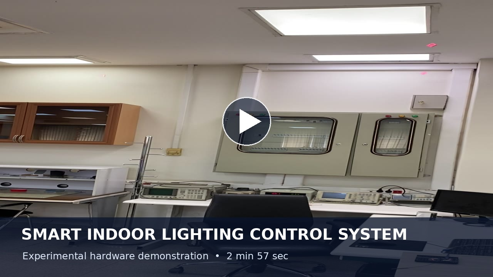
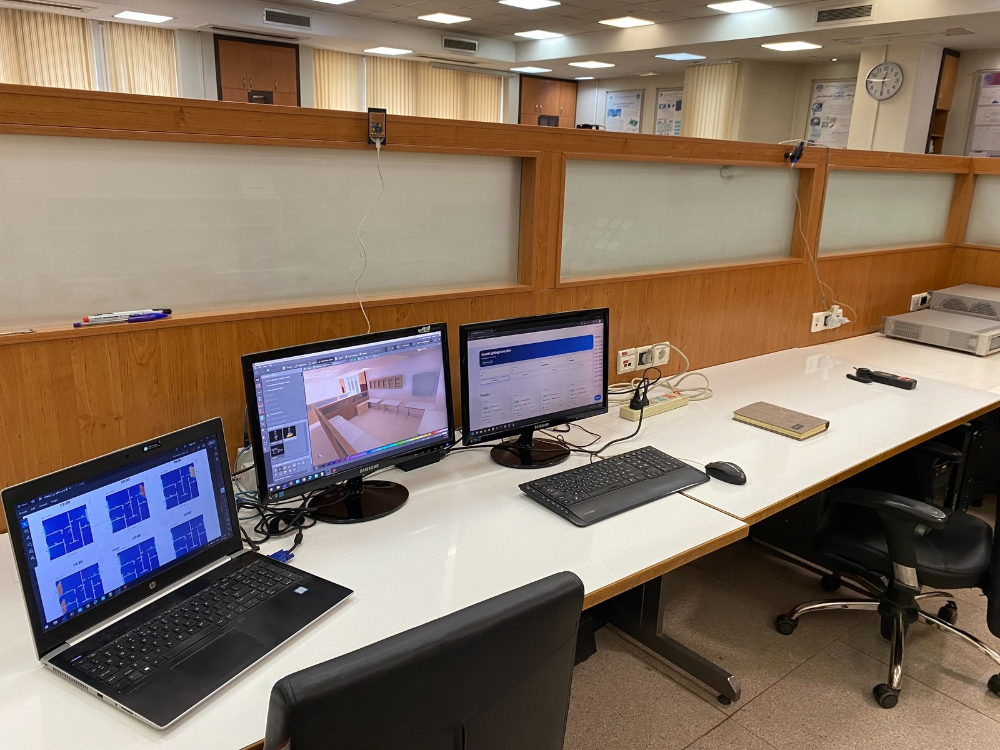
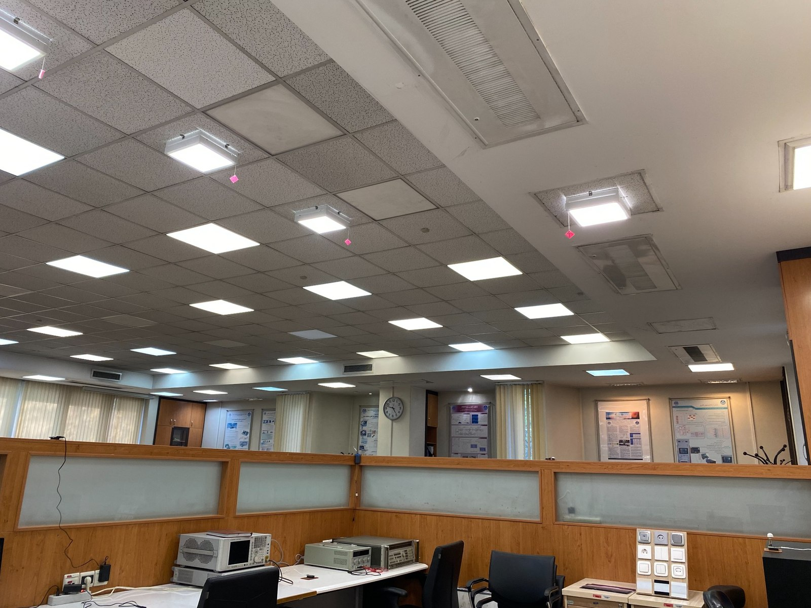
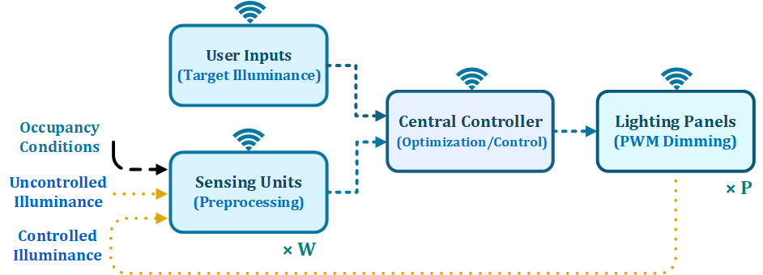

# Smart Indoor Lighting Control System

**Daylight-aware · Occupancy-adaptive · Optimization-based lighting**

**CST Lab | University of Tehran | Research and experimental engineering**

An end-to-end smart indoor lighting platform designed, implemented, and experimentally evaluated at **CST Lab, University of Tehran**. The system integrates custom LED lighting hardware, Wi-Fi-enabled sensing, occupancy detection, daylight estimation, real-time control, and optimization to deliver the required illuminance at occupied workstations with reduced electrical power consumption.

## Experimental demonstration

The video demonstrates an **occupancy-based, daylight-adaptive lighting experiment with a 400 lux target** at the occupied desk. Initially, all lighting panels are off. As I move between desks to test different occupancy locations, the controller activates the relevant panels and calculates appropriate dimming levels based on the available daylight and their measured contributions to the target area.

When a desk becomes vacant, its associated panels switch off after a **15-second delay**. The system illuminates the newly occupied desk using an optimized combination of panels to achieve the target illuminance while minimizing estimated power consumption. At the end of the demonstration, all panels return to the off state.

**[▶ Watch the experimental demonstration on YouTube](https://youtube.com/shorts/Hcsu9ZKmqog?feature=share)** · [More details and media](results-and-media/README.md)

## CST Lab — Experimental testbed

All hardware development, system integration, and laboratory experiments documented in this project were conducted at **CST Lab, University of Tehran**. The testbed comprises instrumented workstations, installed lighting panels, measurement devices, and a central control and monitoring setup.

  
  

<em>Laboratory measurement and control setup (left) and ceiling-mounted lighting-panel installation (right).</em>

## System architecture

User-defined illuminance targets and sensor data are processed by the central controller, which estimates the necessary artificial-light contribution and sends dimming commands to the lighting panels. Occupancy information determines which zones require lighting, while the measured lamp-to-sensor relationships determine which panels can serve each zone most efficiently.

[View the detailed control block diagram](control-and-optimization/images/block_diagram_detailed.png)

## Engineering highlights

- **Custom lighting electronics:** three generations of smart LED panels, modular constant-current LED drivers, capacitive touch switching, and flicker-measurement hardware.
- **Embedded sensing and communication:** ESP8266/ESP32 firmware, Wi-Fi illuminance sensors, mmWave presence sensors, ESP32-CAM, and MQTT integration.
- **Physics-based lighting models:** DIALux electric-light studies and Honeybee/Radiance daylight simulation for spatial illuminance and lighting uniformity.
- **Experimental calibration:** individual-panel measurements to obtain lamp-to-sensor gain coefficients, electrical-light contributions, and lux-per-watt effectiveness.
- **Optimization-based lighting control:** minimum-power linear programming with illuminance constraints and an additional weighted optimization method that penalizes duty non-uniformity and abrupt changes.
- **Occupancy-aware automation:** camera/YOLO and radar-based presence information, zone-specific lux targets, and adaptive dimming.
- **Signal processing:** MATLAB time-domain analysis, FFT, windowing, and spectral-peak extraction for flicker characterization and frequency-oriented calibration.

## Explore the repository

| Section | Contents |
| --- | --- |
| **[Hardware](hardware/README.md)** | Custom LED panels (V1–V3), LED drivers, lighting and presence sensors, touch switches, and flicker meter; PCB images and schematics. |
| **[Embedded Firmware](firmware/README.md)** | ESP8266 and ESP32 firmware for panel dimming, illuminance sensing, occupancy sensors, and camera acquisition. |
| **[Control & Optimization](control-and-optimization/README.md)** | Python/Streamlit central controller, MQTT backend, experimental calibration, LP and weighted optimization, occupancy logic, and dashboard screenshots. |
| **[Modeling & Simulation](modeling-and-simulation/README.md)** | DIALux and Honeybee/Radiance models, daylight maps, illuminance distribution, gain analysis, and zoning. |
| **[Signal Processing & MATLAB](signal-processing/README.md)** | MATLAB FFT scripts, sampled-light waveforms, spectral plots, and flicker analysis. |
| **[Results & Media](results-and-media/README.md)** | Video demonstration and experimental media. |

## Optimization and control

The central controller combines estimated daylight, calibrated panel contributions, zone-specific illuminance targets, and occupancy status. Its **linear programming (LP)** formulation minimizes estimated lighting power while enforcing illuminance targets and PWM duty-cycle limits. A second **weighted SLSQP-based formulation** includes quadratic penalties on differences between active panel duties and on changes from current dimming settings.

The optimization uses the experimentally determined gain matrix and can restrict operation to panels selected for the active zones. See the [control and optimization documentation](control-and-optimization/README.md) for the implementation and dashboard results.

## Related publications

- **Design of a Flicker-Free Smart Lighting Panel with a Custom Low-Cost Flicker Measurement Module** — IEEE SGC 2025. [DOI: 10.1109/SGC69320.2025.11372343](https://doi.org/10.1109/sgc69320.2025.11372343)
- **On-the-Fly Frequency-Oriented Calibration for Real-Time, Power-Efficient, and Dynamic Control of Smart Lighting Systems** — IEEE ICEE 2026. [DOI: 10.1109/ICEE70628.2026.11710520](https://doi.org/10.1109/icee70628.2026.11710520)

---

**Research, design, implementation, and experimental evaluation:** [Mostafa Amiri](https://github.com/Mostafaa-Amiri) · CST Lab, University of Tehran
