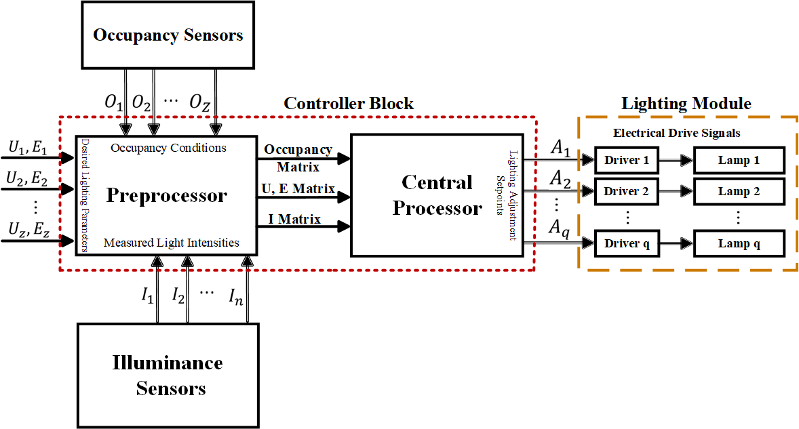
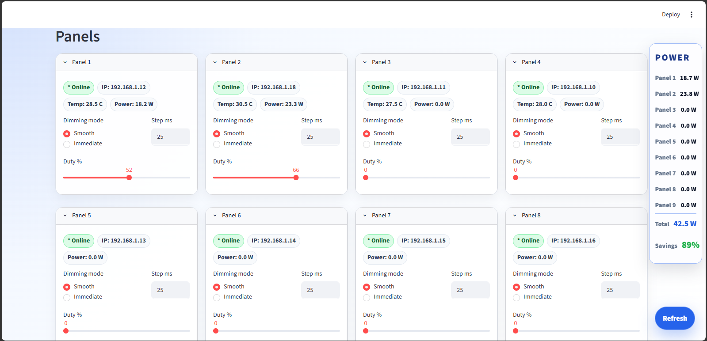
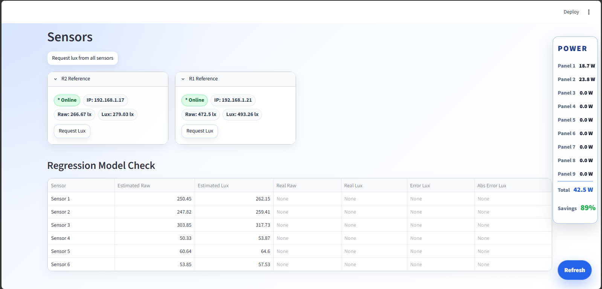
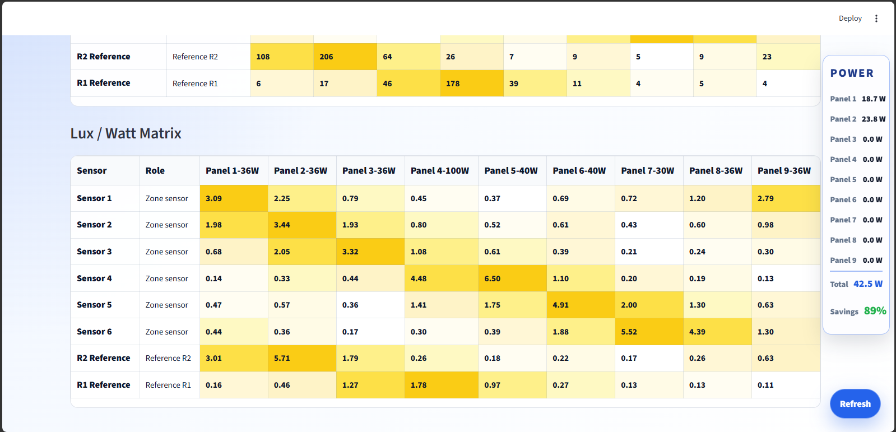

# Control and Optimization

**Smart Indoor Lighting Control System**  
*CST Lab · University of Tehran*

## Overview

The Python-based central controller integrates lighting hardware, illuminance sensing, occupancy detection, experimental calibration, and energy-aware dimming. A Streamlit dashboard provides real-time monitoring, manual control, and automatic control of the **Smart Indoor Lighting Control System**.

## System Architecture

*High-level architecture showing user targets, sensing, central optimization, and dimmable lighting panels.*

*Detailed data flow from occupancy and illuminance measurements through preprocessing and optimization to the LED drivers.*

The MQTT backend exchanges telemetry and control commands with the devices. Calibration supplies the measured **luminaire-to-sensor gain matrix**; the optimization module combines these gains with estimated daylight, occupancy state, and required illuminance to calculate panel duty cycles.

## Implementation

| File | Function |
| --- | --- |
| [`main.py`](central-controller/main.py) | Streamlit dashboard and central coordination of manual control, occupancy, calibration, and automatic dimming. |
| [`mqtt_backend.py`](central-controller/mqtt_backend.py) | MQTT messaging, device discovery, telemetry, acknowledgements, and online/offline status. |
| [`optimizer_lp.py`](central-controller/optimizer_lp.py) | Minimum-power LP and weighted optimization with duty-cycle regularization. |
| [`calibration.py`](central-controller/calibration.py) | Sequential panel calibration, ambient-light measurement, sensor-response acquisition, and gain-matrix construction. |
| [`calibration.json`](central-controller/calibration.json) | Stored experimental calibration data: nine lighting panels and four illuminance sensors (4 × 9 gain matrix). |
| [`occupancy_backend.py`](central-controller/occupancy_backend.py) | YOLO-based person detection, perspective-zone assignment, occupancy stabilization, and MQTT reporting. |
| [`ui_style.py`](central-controller/ui_style.py) | Streamlit presentation and reusable interface components for device, calibration, occupancy, and control views. |

### Core Functions

- **Manual dimming:** set panel duty cycles with immediate or smooth transitions.
- **Automatic calibration:** establish uncontrolled/ambient illuminance, activate panels individually, and record their contributions at each sensor.
- **Daylight estimation:** separate the estimated electric-light contribution from measured illuminance and support reference-sensor-based prediction.
- **Occupancy-aware operation:** combine camera-based zone occupancy and mmWave presence information with zone-specific illuminance targets.
- **Monitoring:** track panel status, illuminance measurements, temperature telemetry where available, current duties, and estimated electrical power.

## Optimization Methods

Both methods use panel duty cycles as decision variables. The calibrated gain matrix maps each panel's duty cycle to its estimated illuminance contribution at the controlled sensors or zones.

### Minimum-Power Linear Programming (LP)

The LP minimizes estimated electrical power subject to minimum illuminance and duty-cycle constraints:

$$
\min_{\mathbf d} \; \sum_j P_j\frac{d_j}{100}
\qquad\text{subject to}\qquad
E_i + \sum_j G_{ij}\frac{d_j}{100} \ge T_i,
\quad 0\le d_j\le100.
$$

Here, $P_j$ is the power of panel $j$ at full output, $d_j$ is its duty cycle (%), $G_{ij}$ is the experimentally calibrated illuminance gain, $E_i$ is estimated uncontrolled illuminance, and $T_i$ is the target illuminance. The implementation uses SciPy's `linprog` with the HiGHS method.

### Weighted Quadratic-Objective Optimization

An alternative objective retains the illuminance constraints but balances power consumption against two squared penalties: differences between the active panels' duty cycles, and changes relative to their previous values.

$$
J(\mathbf d)=\lambda_P P(\mathbf d)
+\lambda_U \operatorname{mean}_{j\in A}(d_j-\bar d_A)^2
+\lambda_\Delta \operatorname{mean}_{j\in A}(d_j-d_j^{\mathrm{prev}})^2.
$$

$A$ denotes the allowed panel set. The weights control the trade-off between **energy use**, **duty uniformity**, and **changes between successive commands**. This is a weighted objective with quadratic penalty terms and linear illuminance constraints; it is solved numerically using SciPy's `minimize` with **SLSQP**. It differs from pure minimum-power LP by discouraging uneven or unnecessarily large duty adjustments.

The controller can restrict the allowed panel set to luminaires selected as efficient for the occupied zones. The source implementation also includes an LP fallback for the weighted solver.

## Experimental Calibration

For each calibration run, the controller measures illuminance with all panels off, then activates each panel separately and records the sensor responses. Subtracting the ambient baseline yields the **luminaire-to-sensor gain matrix**, used to estimate how much each panel contributes at each sensing point.

The included `calibration.json` represents a calibration with **nine panels and four sensors**. The software also contains a configuration with **six zone sensors and two reference sensors** for daylight estimation. The supplied source code and measurement dataset retain their original configurations.

## Experimental Figures

### Panel Control and Monitoring

*Panel status, dimming controls, temperature telemetry, and power estimates.*

### Illuminance Sensors and Regression Estimates

*Reference illuminance sensing and comparison interface for zone illuminance prediction.*

### Occupancy Detection

*Occupancy states and temporal stability information for the detected zones.*

### Occupancy-Dependent Illuminance Targets

*Target illuminance and permitted panel groups for occupied and unoccupied zones.*

### Automatic-Control Diagnostics

*Cycle status and calculated illuminance demand per zone.*

### Reference-Sensor Estimates and Panel Duty Cycles

*Estimated uncontrolled illuminance and calculated PWM duty cycles.*

### Lux-per-Watt Matrix

*Panel effectiveness expressed as estimated illuminance contribution per unit of electrical power.*

### YOLO-Based Occupancy Zones

*Camera-based detection and assignment of people to predefined workstation zones.*

## Related Documentation

[Main Project Overview](../README.md) · [Embedded Firmware](../firmware/README.md) · [Hardware Development](../hardware/README.md) · [Modeling and Simulation](../modeling-and-simulation/README.md)
