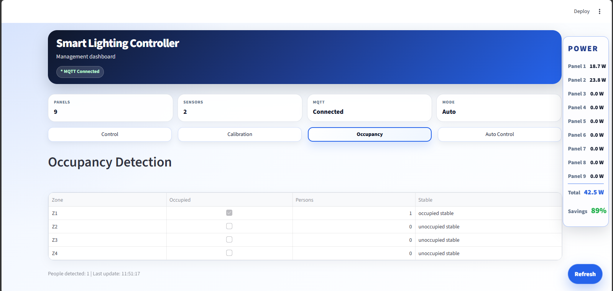
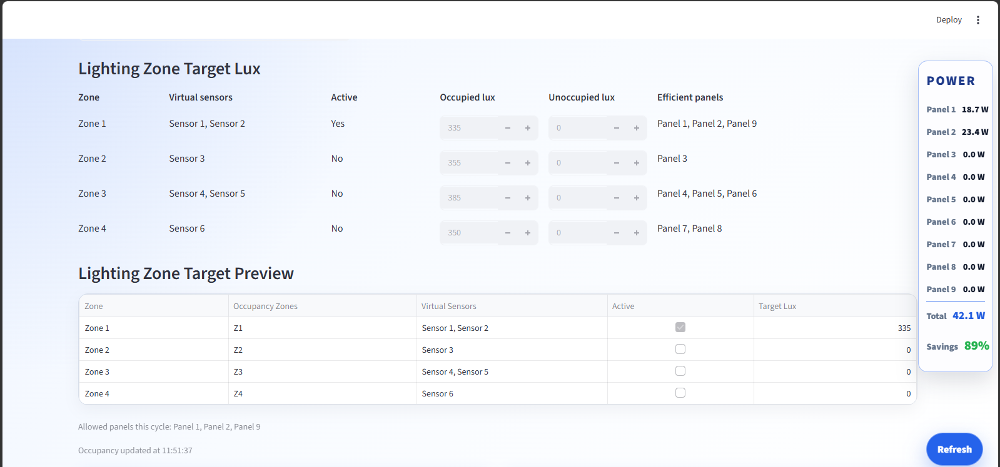
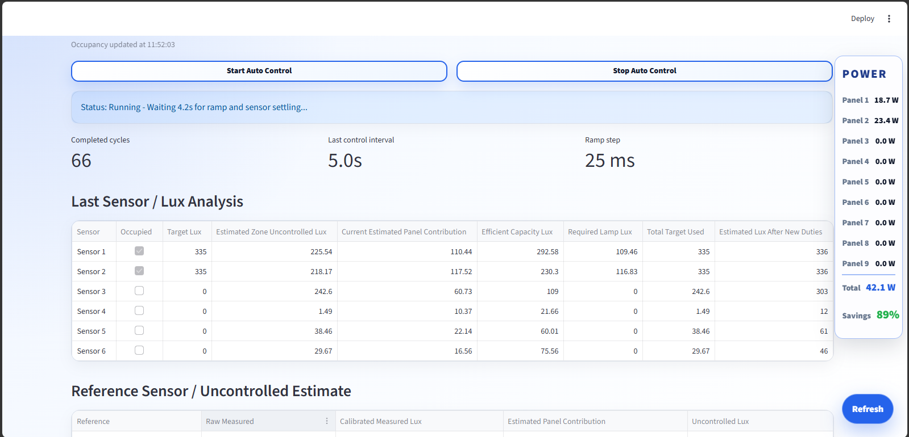
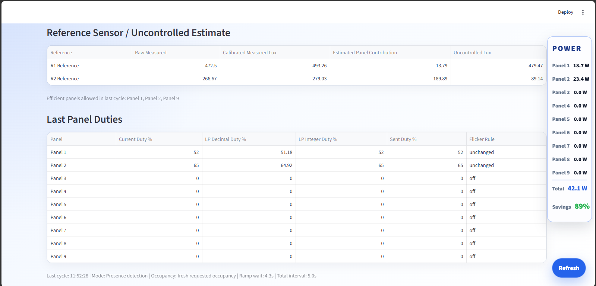
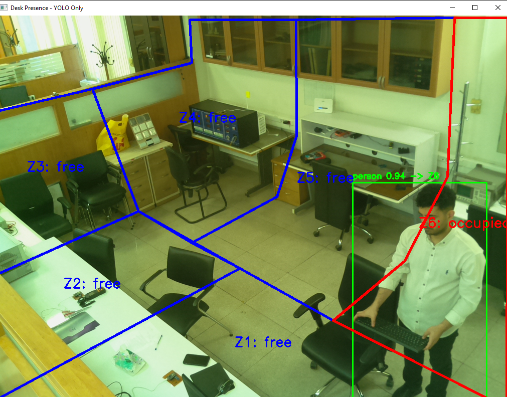

# Central Lighting Controller

**Smart Indoor Lighting Control System · University of Tehran**

This experimentally developed Python controller integrates wireless lighting hardware, illuminance measurements, occupancy sensing, automated calibration, daylight estimation, and optimization-based dimming in a real-time management dashboard.

## Architecture

**Streamlit dashboard** (`main.py`, `ui_style.py`) ↔ **MQTT communication** (`mqtt_backend.py`) ↔ **LED panels and wireless sensors**

The controller combines measured lux, occupancy information, and the experimentally obtained sensor–panel gain matrix to calculate new dimming commands and publish them to the lighting network.

## Software modules

| File | Engineering function |
| --- | --- |
| [`main.py`](central-controller/main.py) | Central Streamlit application for panel control, sensor monitoring, calibration, occupancy management, and automatic lighting control. |
| [`mqtt_backend.py`](central-controller/mqtt_backend.py) | MQTT device discovery, telemetry, command publishing, acknowledgements, and connection monitoring. |
| [`optimizer_lp.py`](central-controller/optimizer_lp.py) | Optimization engine: hard-target linear programming and weighted duty optimization. |
| [`calibration.py`](central-controller/calibration.py) | Experimental calibration: measure ambient light, activate panels one by one, acquire sensor responses, construct the gain matrix, and preserve calibration history. |
| [`calibration.json`](central-controller/calibration.json) | Recorded calibration dataset for nine panels and four illuminance sensors (4 × 9 gain matrix). |
| [`occupancy_backend.py`](central-controller/occupancy_backend.py) | Camera-based person detection with YOLO, perspective-zone mapping, temporal occupancy filtering, and MQTT publishing. |
| [`ui_style.py`](central-controller/ui_style.py) | Dashboard styling and UI components for status, power, calibration results, and controls. |

## Controller capabilities

- **Manual lighting control:** individual panel dimming with immediate or smooth transitions.
- **Automated experimental calibration:** ambient measurement, per-panel activation, sensor response acquisition, and gain-matrix generation.
- **Optimization-based control:** calculates dimming levels from target lux, estimated daylight, calibration gains, and panel-power data.
- **Daylight-aware operation:** estimates uncontrolled lux by subtracting the estimated electric-light contribution from measured lux.
- **Occupancy-aware lighting:** camera-based four-zone occupancy detection and mmWave-based occupancy support.
- **Live monitoring:** panel duty, measured lux, estimated power, target lux, and automatic-control diagnostics.

## Optimization approach

The controller uses two optimization strategies.

### 1) Minimum-energy linear programming

The primary LP computes panel duties that satisfy the lux constraints while minimizing estimated electrical power:

- **Decision variables:** panel duty cycles
- **Constraint:** each controlled sensor/zone must reach its required lamp lux
- **Objective:** minimize total weighted electrical power

This method is used when the goal is the lowest-power feasible solution.

### 2) Weighted smooth-duty optimization

A second optimization mode extends the basic power-minimization problem with additional weighted penalties. Its objective combines:

- **power consumption**
- **duty non-uniformity** among the allowed active panels
- **duty change** relative to the current panel settings

The implemented solver uses `scipy.optimize.minimize` with **SLSQP**. Because the regularization terms are based on mean-squared duty deviations and duty changes, this formulation is effectively a **weighted quadratic-like optimization** solved numerically. In practical terms, it aims to produce solutions that are not only energy-efficient, but also smoother, more balanced, and less aggressive in step-to-step changes.

### About nonlinear / quadratic optimization

In this released controller, the implemented advanced method is the weighted SLSQP-based optimization described above. It can be viewed as a nonlinear numerical solution of a weighted objective with quadratic penalty terms. This was useful for exploring trade-offs beyond pure minimum-power LP, especially when smoother lighting behavior and more regular panel usage were desired.

## Calibration data

The included `calibration.json` belongs to this controller version and records **nine panels and four sensors**. The application also defines a wider configuration of **six zone sensors and two reference sensors** for its reference-based automatic-control path. Both the source configuration and the supplied recorded dataset are retained unchanged.

## Dashboard screenshots

### Main dashboard / Auto Control overview

### Occupancy page

### Target-lux configuration

### Auto-control diagnostics

### Reference-sensor daylight estimate and final panel duties

### YOLO occupancy-zone detection

For circuit designs, devices and sensor hardware, see the [hardware documentation](../hardware/README.md). Arduino/ESP device firmware is documented in the [firmware directory](../firmware/README.md).
