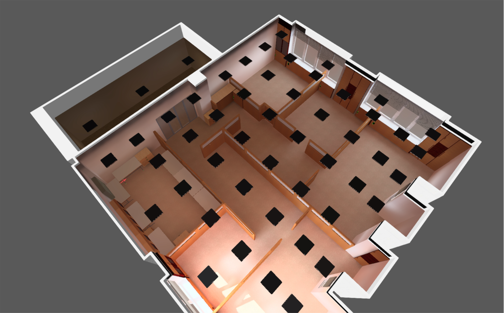
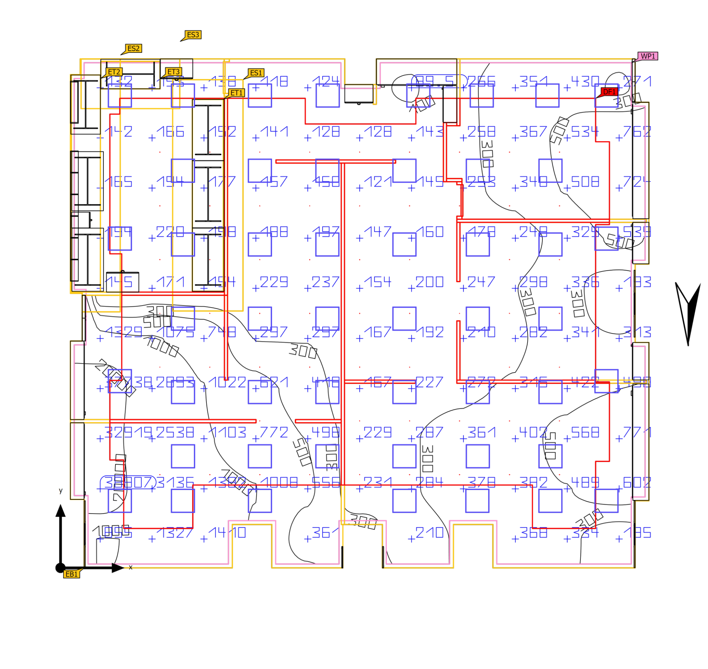
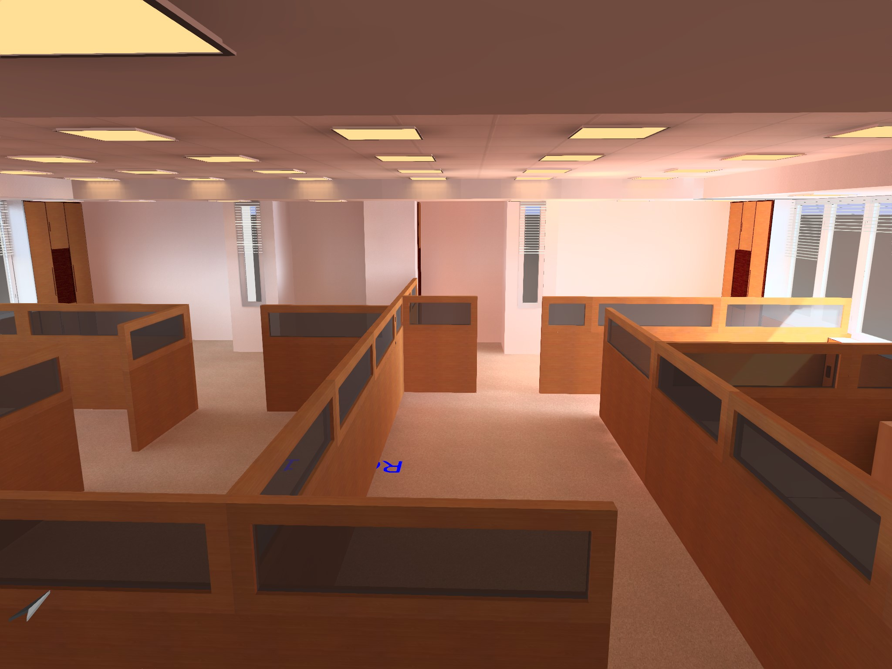
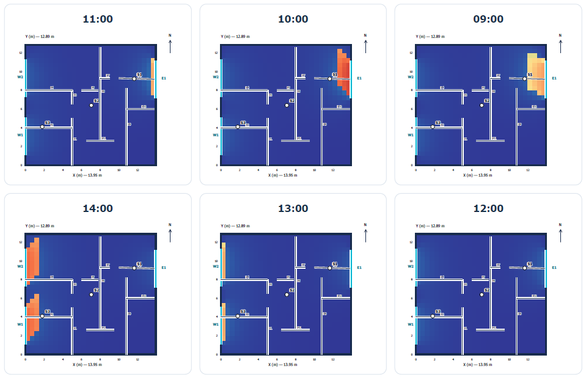
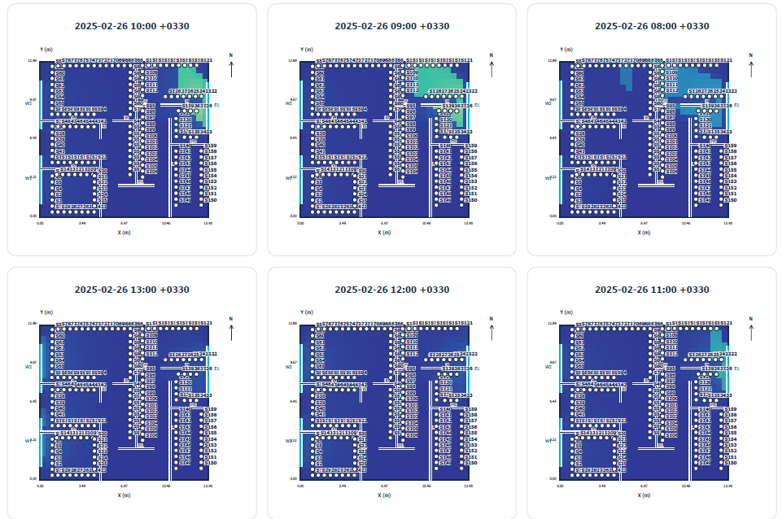
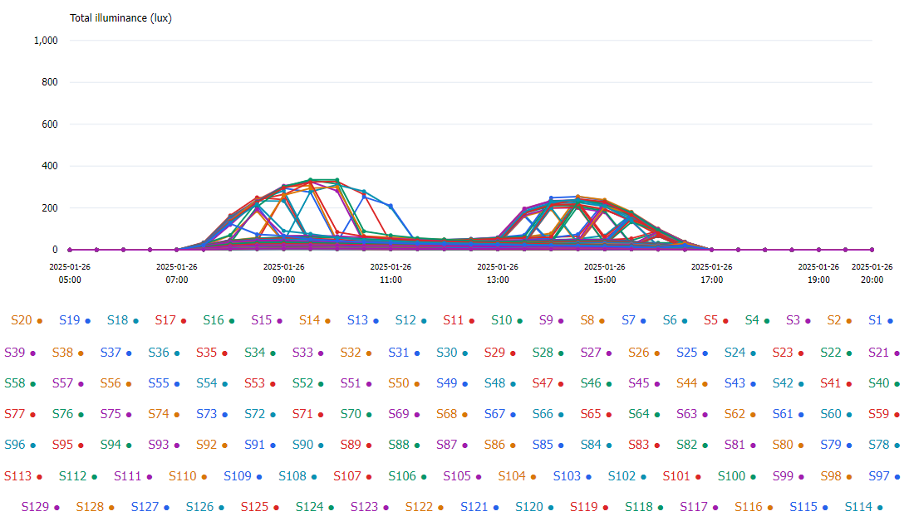

# Modeling and Simulation

**Smart Indoor Lighting Control System**  
*CST Lab · University of Tehran*

## Overview

The modeling work supports the design and control of the **Smart Indoor Lighting Control System** through simulation of electric lighting, daylight, and spatial illuminance distributions. The workflow combines **DIALux**, **Honeybee/Radiance**, and mathematical analysis to study panel layout, illuminance uniformity, daylight prediction, zone definition, and reduced-sensor strategies.

## Modeling Approach

### Electric Lighting — DIALux

The laboratory geometry, windows, partitions, work areas, and luminaire positions were represented in DIALux to examine the distribution of artificial light, the influence of panel placement, and the expected coverage of each zone. Illuminance levels and uniformity were analyzed to guide the lighting layout and its experimental implementation.

### Daylight — Honeybee/Radiance

Honeybee/Radiance was used to simulate time-varying daylight throughout the same environment. The results characterize the spatial effects of windows and changing daylight conditions, supporting estimates of **uncontrolled illuminance** at different sensing points.

## Simulation Figures

### DIALux — Three-Dimensional Lighting Layout

*Three-dimensional representation of the laboratory and luminaire arrangement.*

### DIALux — Plan-View Illuminance and Zoning

*Work-plane illuminance and spatial distribution used to assess zone coverage and uniformity.*

### Honeybee/Radiance — Interior Lighting Model

*Interior model used for daylight and lighting studies.*

### Time-Dependent Daylight Distribution

*Simulated illuminance at representative times, illustrating changes in daylight penetration.*

### Daylight at Virtual Sensor Locations

*Daylight predictions at distributed candidate sensing locations.*

### Daily Illuminance Profiles

*Time-series results used to compare the daylight response of candidate sensor positions.*

## Control-Oriented Analysis

### Daylight Estimation and Reduced Sensing

A central goal was to estimate daylight conditions across multiple work areas using fewer physical illuminance sensors. Simulated virtual-sensor data was analyzed to investigate the relationship between representative measurements and the remaining points, providing a basis for reference-sensor-based prediction in the controller.

### Luminaire-to-Sensor Gain Matrix and Lux-per-Watt Analysis

The contribution of each lighting panel to each sensing point is represented by a **luminaire-to-sensor gain matrix**. Combined with each panel's electrical power, these gains allow comparison of **illuminance contribution per watt** and identification of panels that can serve specific zones efficiently.

In the implemented system, the controller obtains its gain matrix through individual-panel experimental calibration; the modeling work complements this process by analyzing spatial lighting relationships and panel placement.

### Zoning and Uniformity

Lighting zones were defined around work areas to connect occupancy information with the illuminance targets and the panels most relevant to each zone. Simulation and numerical analysis also supported evaluation of average illuminance, uniformity, and coverage overlap.

### Sensor Placement and Clustering

The daylight simulation dataset was used to investigate **clustering of locations with similar daylight behavior** and selection of representative sensing positions. This provided a mathematical basis for comparing sensor-count reduction against prediction accuracy without requiring a separate sensor at every virtual measurement point.

## Related Documentation

[Main Project Overview](../README.md) · [Control and Optimization](../control-and-optimization/README.md) · [Hardware Development](../hardware/README.md)
