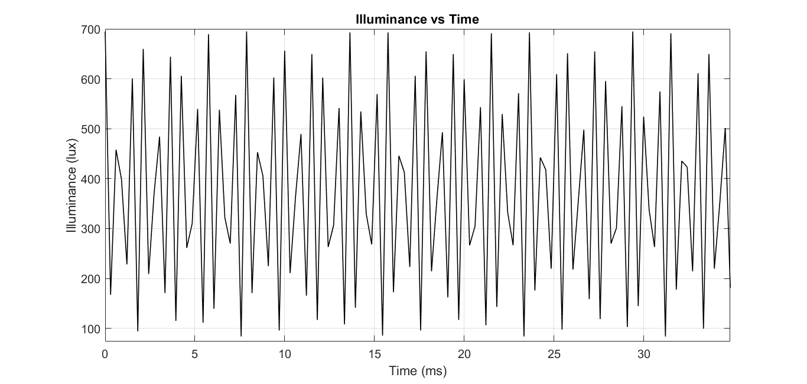
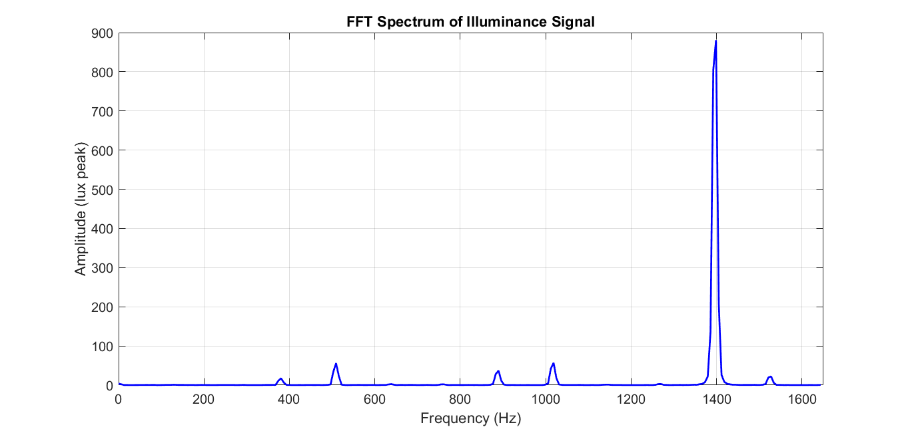
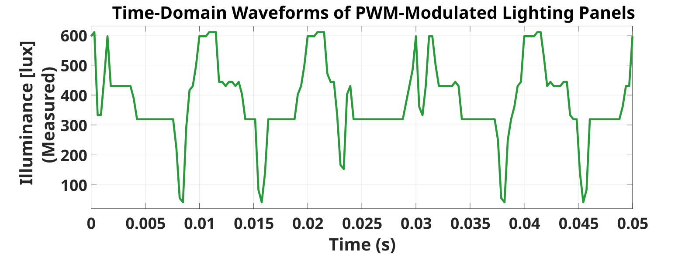
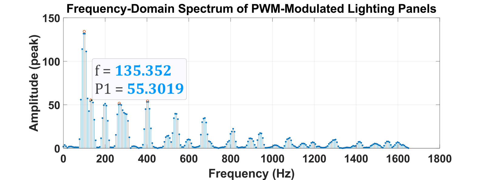
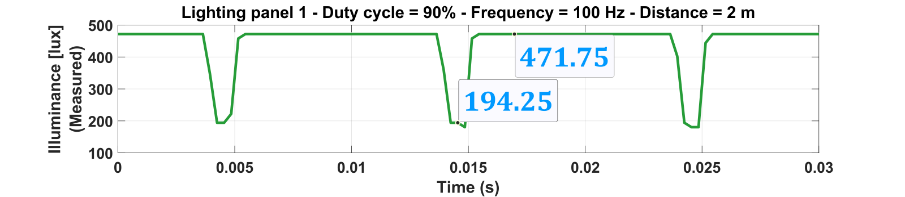

# Signal Processing and Flicker Characterization

**Smart Indoor Lighting Control System**  
*CST Lab · University of Tehran*

## Overview

This section documents the MATLAB signal-processing methods used to analyze optical measurements from the smart-lighting experiments. Time- and frequency-domain processing was applied to characterize **PWM-modulated illuminance**, identify dominant spectral components, and support the project's frequency-oriented calibration research.

## Signal-Processing Methodology

The measurement sequence is processed in the time domain and then transformed using the **fast Fourier transform (FFT)**. The MATLAB workflows include:

1. **DC removal** to separate the fluctuating component from the signal's average value.
2. **Windowing** using a five-term Flattop or Hann window to manage spectral leakage.
3. **Single-sided FFT normalization** and **coherent-gain compensation** for amplitude interpretation.
4. **Spectral peak detection** and parabolic interpolation to estimate dominant frequencies and amplitudes.
5. **Peak grouping** in the applicable scripts to avoid reporting nearby peaks separately.

The Flattop and Hann implementations allow comparison between amplitude-focused analysis and the DSP pipeline used for ESP32-based processing. The separate frequency-axis rescaling variant is a display transformation, not a different physical measurement frequency.

## MATLAB Implementation

| MATLAB script | Purpose |
| --- | --- |
| [`fft_flattop_amplitude_corrected.m`](matlab/fft_flattop_amplitude_corrected.m) | Flattop-window FFT, sample scaling, amplitude correction, peak interpolation, and merging of nearby reported peaks. |
| [`fft_flattop_frequency_rescaled.m`](matlab/fft_flattop_frequency_rescaled.m) | Flattop FFT with an intentionally rescaled frequency/time axis for visualization. |
| [`fft_flattop_time_frequency.m`](matlab/fft_flattop_time_frequency.m) | Time-domain and single-sided frequency-domain plots with prominent-peak extraction. |
| [`fft_hann_esp32_comparison.m`](matlab/fft_hann_esp32_comparison.m) | Hann-window FFT and peak analysis designed for comparison with the ESP32 signal-processing pipeline. |

The scripts retain their original computations and parameters. Computer-specific input paths were replaced with relative CSV filenames: `data4.csv`, `data20.csv`, `data16.csv`, and `data5.csv`.

## Experimental Figures

### Measured Illuminance — Time Domain

*Time-domain illuminance variations recorded during a lighting experiment.*

### Measured Illuminance — Frequency Domain

*FFT spectrum used to identify dominant modulation-related frequency components.*

### PWM-Modulated Light — Time Domain

*Measured optical waveform under PWM dimming.*

### PWM-Modulated Light — Frequency Domain

*Frequency-domain representation of the corresponding PWM-modulated signal.*

### Additional PWM Waveform

*Measured waveform labeled with 90% PWM duty cycle, 100 Hz nominal modulation frequency, and 2 m measurement distance.*

## Related Documentation

The mathematical approach and frequency-oriented calibration method are discussed in **On-the-Fly Frequency-Oriented Calibration for Real-Time, Power-Efficient, and Dynamic Control of Smart Lighting Systems** ([IEEE ICEE 2026](https://doi.org/10.1109/ICEE70628.2026.11710520)).

[Main Project Overview](../README.md) · [Hardware Development](../hardware/README.md) · [Control and Optimization](../control-and-optimization/README.md)
